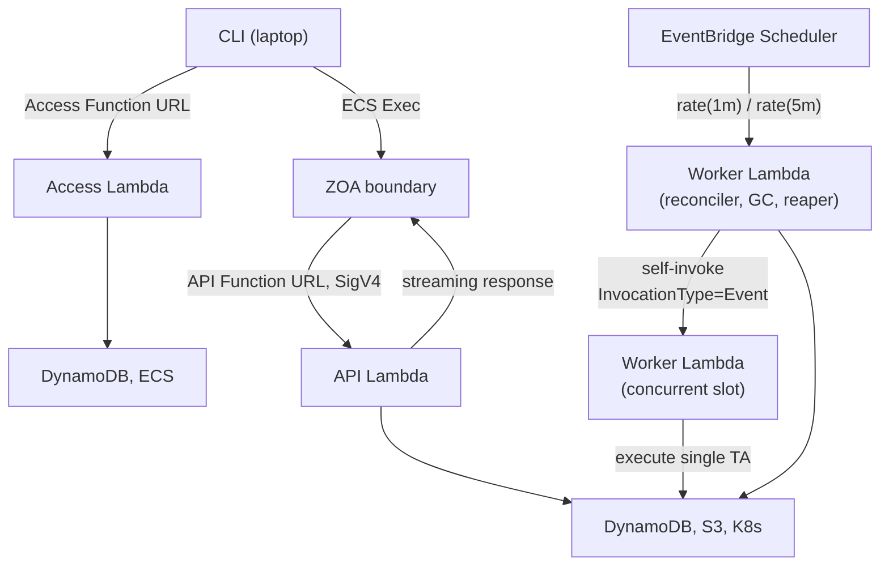

# ZOA Lambda Model

## Overview

ZOA deploys **multiple Lambda functions per deployment**:

| Lambda     | Trigger                   | Purpose                                                                                 |
| ---------- | ------------------------- | --------------------------------------------------------------------------------------- |
| **API**    | Function URL (IAM auth)   | CLI requests, sync TAs, streaming downloads (per VPC: RC + each MC)                     |
| **Worker** | EventBridge + self-invoke | Reconciler (1m), GC (5m), **boundary session reaper** (5m), break-glass expiry/GC, async/approved TA execution |
| **Access** | Function URL (IAM auth)   | ZOA boundary session lifecycle, target discovery (RC account, no VPC)                   |

API, Worker, and Access use the **same container image** (`zoa-lambda`), differentiated by the `HANDLER_MODE` environment variable (`api`, `worker`, `access`).

**Break-glass** lives on the **API** Lambda (per target VPC): `BREAKGLASS_TABLE`, handlers under `pkg/api/breakglass*.go`, credentials via `pkg/executor` + `pkg/breakglass`. The **Worker** runs `breakglassExpireGrants` and RBAC GC (`pkg/scheduler/breakglass_gc.go`). **Access** serves laptop `approve` / `reject` only (no break-glass list from the laptop API). One regional DynamoDB table holds grants for all targets in the deployment; each API Lambda still enforces `TARGET_CLUSTER` on activate.

## Why Separate Functions

Each Lambda has different operational characteristics that are per-function AWS settings:

| Setting              | API                      | Worker                          | Access                          |
| -------------------- | ------------------------ | ------------------------------- | ------------------------------- |
| Invocation           | Function URL (streaming) | EventBridge + self-invoke       | Function URL (standard)         |
| VPC                  | Yes (EKS access)         | Yes (EKS access)                | No (ECS RunTask, DynamoDB only) |
| Lambda timeout       | 300s (default)           | 300s (default)                  | **30s** (session APIs only)     |
| Reserved concurrency | `lambda_api_concurrency` | `lambda_worker_concurrency`     | `lambda_access_concurrency`     |
| Throttle behavior    | HTTP 429 to caller       | AWS queues + retries (up to 6h) | HTTP 429 to caller              |

These cannot share a single function because timeout, concurrency, invocation mode (streaming vs standard handler), and VPC attachment are per-function settings.

Timeout and concurrency values are configured in Terraform (`terraform/modules/zoa-lambda/variables.tf`, `terraform/modules/zoa-access/`).

## Event Routing

The Worker Lambda uses the `route` field in the event payload:

```json
{"route": "reconciler"}
{"route": "gc"}
{"route": "reaper"}
{"route": "execute", "execution_id": "abc123"}
```

The **reaper** route enforces boundary **deadline**, **stale creating**, and **idle** policies: queries **`target-status-index`** on the sessions table for `TARGET_CLUSTER`, correlates ECS Exec activity via SSM/CloudWatch for idle, and calls `ecs:StopTask` when needed (`pkg/scheduler/reaper.go`, scheduled from `terraform/modules/zoa-lambda/main.tf`). See [session reaper](../boundary/session-reaper.md).

Phase order, DynamoDB tables, and per-step behavior for all worker routes: **[Worker routes](worker-routes.md)**.

## Self-Invocation Pattern

When the reconciler dispatches an approved TA:

1. Reconciler queries DynamoDB for `status=approved` executions
2. Atomically transitions each to `status=dispatched` (conditional write)
3. Invokes itself with `InvocationType=Event` (async, fire-and-forget):
   ```go
   lambdaClient.Invoke(ctx, &lambda.InvokeInput{
       FunctionName:   aws.String(os.Getenv("AWS_LAMBDA_FUNCTION_NAME")),
       InvocationType: lambdatypes.InvocationTypeEvent,
       Payload:        []byte(`{"route":"execute","execution_id":"abc123"}`),
   })
   ```
4. AWS Lambda queues the invocation and executes it in a separate concurrent slot

### Concurrency Model

Each Lambda has its own `reserved_concurrent_executions` pool (`lambda_api_concurrency`, `lambda_worker_concurrency`, `lambda_access_concurrency`):

- **API Lambda** — each concurrent request from a boundary task (or laptop CI) uses one slot. Under saturation, excess requests get throttled (429).
- **Worker Lambda** — scheduled ticks (reconciler, GC, reaper) and self-invoked TA executions share the worker pool. Excess invocations queue in Lambda's internal retry queue (up to 6 hours).
- **Access Lambda** — laptop `zoa session` / discovery calls; isolated from API/Worker so session APIs stay available under TA load (production defaults in [rosa-seaplane ZOA ADR](https://github.com/openshift-online/rosa-seaplane/blob/main/docs/design/zoa-architecture.md)).

Reserved concurrency guarantees slots are not stolen by other functions in the account and caps fan-out cost. Ephemeral environments typically use **-1** (unreserved) for all three. See `terraform/modules/zoa-lambda/variables.tf` and `terraform/modules/zoa-access/`.

Session **deadline / stale creating / idle** policy is not Lambda-timeout-driven — see [Timeout tuning — boundary sessions](timeout-tuning.md#access-lambda-and-boundary-sessions).

## Code-Level Deadlines

Each route gets a `context.WithTimeout` enforced in code:

| Route        | Deadline | Why                                      |
| ------------ | -------- | ---------------------------------------- |
| `reconciler` | 55s      | Must finish quickly; runs every 60s      |
| `gc`         | 55s      | Cleanup can be deferred; runs every 5min |
| `reaper`     | 55s      | Session enforcement; runs every 5min     |
| `execute`    | 295s     | TA execution; bounded by Lambda timeout  |

All values are **env-var tunable** without code redeployment.

## Batch Limits

Each scheduled phase processes at most `MAX_BATCH_PER_TICK` items (default 30). If:

- The batch limit is reached, or
- `ctx.Err() != nil` (deadline approaching)

...remaining items are deferred to the next tick. This prevents timeout under load.

## Data Flow



## Cross-Account Access (MC Lambdas)

MC Lambdas access RC data layer (DynamoDB, S3, KMS) via resource-based policies:

- DynamoDB: `aws_dynamodb_resource_policy` allowing the MC Lambda role
- S3: Bucket policy with `AllowCrossAccountLambdaAccess`
- KMS: Key policy with `AllowCrossAccountLambdaKMS`

No STS AssumeRole needed for data access — policies are on the resources themselves.

## Design Decisions

| Decision                | Rationale                                                                 |
| ----------------------- | ------------------------------------------------------------------------- |
| Self-invoke over SQS    | Simpler (no queue config), automatic retries, Lambda handles backpressure |
| Reserved concurrency    | Prevents noisy-neighbor issues; caps cost                                 |
| 300s Lambda timeout     | Gives 295s for code; handles slow TAs without hitting AWS 900s limit      |
| Same binary             | Zero divergence; route by env var + event payload                         |
| Access via Function URL | IAM auth without API Gateway; SSM publishes URL for CLI discovery         |
| EMF metrics             | CW Exporter already scrapes CloudWatch; EMF is zero-config                |
| SQS DLQ                 | Catch failures from EventBridge and self-invocations                      |
