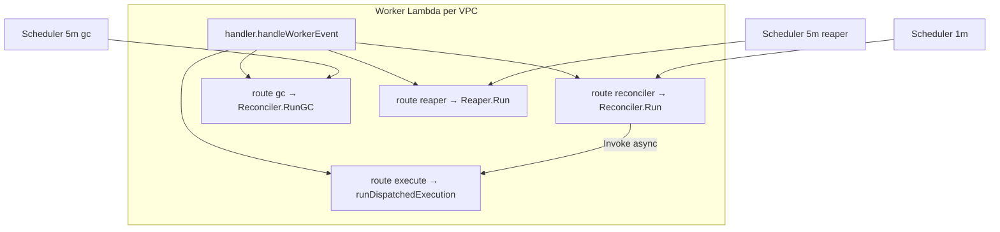

# ZOA Worker — routes and scheduled phases

The **Worker Lambda** (`HANDLER_MODE=worker`, one per target VPC: RC and each MC) handles **Trusted Actions** dispatch/execution, **break-glass** hygiene, and **boundary session** enforcement. It does **not** serve HTTP; the **API** and **Access** Lambdas handle operator-facing flows.

Implementation entry: `pkg/handler/handler.go` → `pkg/scheduler/`. Terraform schedules: `terraform/modules/zoa-lambda/main.tf` in [rosa-seaplane](https://github.com/openshift-online/rosa-seaplane).

See also [Lambda model](lambda-model.md), [implementation](implementation.md), [session reaper](../boundary/session-reaper.md), [break-glass credential architecture](../break-glass/credential-architecture.md).

## How an invocation is routed

| Event payload                            | Handler                                           | Primary type                        |
| ---------------------------------------- | ------------------------------------------------- | ----------------------------------- |
| `{"route":"reconciler"}`                 | `handleScheduledEvent` → `Reconciler.Run`         | EventBridge ~1 min                  |
| `{"route":"gc"}`                         | `handleScheduledEvent` → `Reconciler.RunGC`       | EventBridge ~5 min                  |
| `{"route":"reaper"}`                     | `handleScheduledEvent` → `Reaper.Run`             | EventBridge ~5 min                  |
| `{"route":"execute","execution_id":"…"}` | `handleExecutionEvent` → `runDispatchedExecution` | Self-invoke from `dispatchApproved` |

Scheduled routes use `RECONCILER_DEADLINE_SECONDS` (default 55s). `execute` uses `EXECUTION_DEADLINE_SECONDS` (default ~295s).

Each route is a **separate Lambda invocation** (not a chain inside one run). Multiple schedules can overlap; they share the worker reserved concurrency pool.

## Route: `reconciler` (1 minute)

`Reconciler.Run` — TA hot path first, then TA GC, then break-glass GC (same order as `RunGC` for shared phases).

| Step | Method (`*Reconciler`)       | Pillar | What it does                                                                                                                                                 |
| ---- | ---------------------------- | ------ | ------------------------------------------------------------------------------------------------------------------------------------------------------------ |
| 1    | `dispatchApproved`           | TA     | GSI `target-status-index` → `status=approved`; conditional write to `dispatched`; self-invoke worker with `route=execute`.                                   |
| 2    | `pollAsyncJobs`              | TA     | For `dispatched` + `executionMode=async`: read Job `zoa-<executionId>` in `ZOA_JOBS_NAMESPACE`; transition to `succeeded`/`failed`.                          |
| 3    | `timeoutDispatched`          | TA     | `dispatched` older than execution timeout (+ async overhead) → `timed_out`; delete async Job if present.                                                     |
| 4    | `garbageCollect`             | TA     | Terminal executions past GC delay → `CleanupExecution`; `MarkCleaned` on execution row.                                                                      |
| 5    | `orphanGC`                   | TA     | List Jobs `app.kubernetes.io/managed-by=zoa`; if **no** execution row and age > 30m → cleanup.                                                               |
| 6    | `cleanupStaleMustGatherPods` | TA     | Terminal must-gather child pods (label `zoa.openshift.io/component=must-gather`), age > 30m.                                                                 |
| 7    | `breakglassExpireGrants`     | BG     | Optional (`breakglassStore` set). Query `pending`/`active` on break-glass table; past `requestExpiresAt` / `grantExpiresAt` → `status=expired`, `expiredAt`. |
| 8    | `breakglassGarbageCollect`   | BG     | Query `expired`, `cleaned=false`; kube profiles → `CleanupBreakglass(requestId)`; `MarkCleaned`.                                                             |
| 9    | `breakglassOrphanGC`         | BG     | List SAs with `managed-by=zoa` + `request-id` label; if Dynamo missing or not pending/active → cleanup.                                                      |

Phase errors increment `phaseErrors` and are logged; later phases still run (unless panic or context cancelled). `MAX_BATCH_PER_TICK` limits several TA loops.

**Break-glass note:** approve, activate, and credentials are **API** paths (synchronous). Worker BG steps are **lifecycle + kube hygiene** only.

## Route: `gc` (5 minutes)

`Reconciler.RunGC` — catch-up for TA and BG cleanup when the 1m tick did not finish (batch limits, load). **No** dispatch, poll, or timeout.

| Step | Method                       | Pillar |
| ---- | ---------------------------- | ------ |
| 1    | `garbageCollect`             | TA     |
| 2    | `orphanGC`                   | TA     |
| 3    | `cleanupStaleMustGatherPods` | TA     |
| 4    | `breakglassExpireGrants`     | BG     |
| 5    | `breakglassGarbageCollect`   | BG     |
| 6    | `breakglassOrphanGC`         | BG     |

Same functions and semantics as steps 4–9 on the reconciler route.

## Route: `reaper` (5 minutes)

`Reaper.Run` — **boundary sessions** only (ECS boundary tasks + DynamoDB `SESSIONS_TABLE`). Not TA or break-glass.

Requires `SESSIONS_TABLE` on the worker. Scoped to `TARGET_CLUSTER` for this deployment.

| Step | Method             | What it does                                                                                                                              |
| ---- | ------------------ | ----------------------------------------------------------------------------------------------------------------------------------------- |
| 1    | `runDeadline`      | GSI `target-status-index`: sessions past `deadline` (`creating` or `active`) → `ecs:StopTask`, `status=terminated`, `deadlineReaperStop`. |
| 2    | `runStaleCreating` | `creating` rows older than `SESSION_STALE_CREATING_SECONDS` → stop + terminate.                                                           |
| 3    | `runIdle`          | `active` with `taskId`: SSM + CloudWatch activity; idle longer than `SESSION_IDLE_TIMEOUT_SECONDS` → stop + `idleReaperStop`.             |

Unlike `Reconciler.Run`, an error in `runDeadline` **returns early** and skips stale/idle in that invocation (see [session reaper](../boundary/session-reaper.md)).

## Route: `execute` (on demand)

`runDispatchedExecution` — one **Trusted Action** per invocation.

1. Load execution from `EXECUTION_TABLE`; require `status=dispatched` (idempotent skip if already progressed).
2. Sync: impersonate `zoa-exec-<id>` SA, run action, S3 artifacts, terminal status.
3. Async: create Job `zoa-<id>` (labels include `zoa.openshift.io/execution-id`); reconciler polls Job on later ticks.

No break-glass or session logic on this route.

## DynamoDB and labels cheat sheet

| Pillar        | Table / index                                                | K8s labels (GC)                                                                     |
| ------------- | ------------------------------------------------------------ | ----------------------------------------------------------------------------------- |
| TA executions | `EXECUTION_TABLE`, GSI `target-status-index`                 | Jobs/Pods: `managed-by=zoa`, `zoa.openshift.io/execution-id`                        |
| Break-glass   | `BREAKGLASS_TABLE`, GSI `target-status-index`                | SA/RBAC: `managed-by=zoa`, `zoa.openshift.io/request-id`, name `zoa-bg-<requestId>` |
| Sessions      | `SESSIONS_TABLE`, GSI `target-status-index`, `task-id-index` | ECS task tags + session fields (not `zoa-jobs`)                                     |

## What runs where (operator mental model)

| Operator action                       | Lambda                                 | Worker route                         |
| ------------------------------------- | -------------------------------------- | ------------------------------------ |
| `zoa run` (sync/async via API)        | API (+ worker `execute` if async path) | `execute` when async dispatched      |
| TA approval (future / laptop)         | Access/API                             | `reconciler` step 1 when approved    |
| `zoa breakglass request` / `activate` | API                                    | — (worker only expires/cleans later) |
| `zoa session start`                   | Access                                 | `reaper` enforces end of session     |

## Code map

| File                             | Contents                                                                                         |
| -------------------------------- | ------------------------------------------------------------------------------------------------ |
| `pkg/scheduler/reconciler.go`    | `Run`, `dispatchApproved`, `pollAsyncJobs`, `timeoutDispatched`                                  |
| `pkg/scheduler/gc.go`            | `RunGC`, TA `garbageCollect`, `orphanGC`, `cleanupStaleMustGatherPods`                           |
| `pkg/scheduler/breakglass_gc.go` | `SetBreakglassStore`, `breakglassExpireGrants`, `breakglassGarbageCollect`, `breakglassOrphanGC` |
| `pkg/scheduler/reaper.go`        | `Reaper.Run`, deadline / stale / idle                                                            |
| `cmd/zoa-lambda/main.go`         | Wire store, executor, `SetBreakglassStore`, `NewReaper` when tables set                          |
