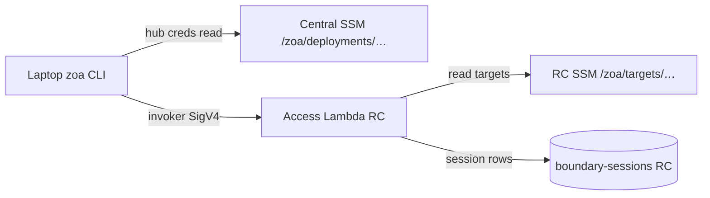

# ZOA Boundary — Architecture

## Role

ZOA Boundary is an **ephemeral jump server** in the **same VPC** as the target EKS cluster, with purpose-built tooling (`zoa` CLI, `kubectl`, `aws` CLI v2, Claude Code, `jq`). Interactive work is recorded to **CloudWatch** (container stdout + ECS Exec PTY transcripts). The container calls the **per-VPC API Lambda** (`ZOA_API_URL`) for Trusted Actions.

Design principles:

1. **Ephemeral** — No persistent disk state. TA artifacts live in **S3**; session metadata in **DynamoDB**. Flow: `session start` → work → **`session terminate`** from the laptop (or reaper).
2. **Shareable execution IDs** — Any authorized operator can inspect a TA run with `zoa get` / `zoa output` / `zoa runs` without sharing a session.
3. **Single CLI** — `zoa` covers sessions, TAs, discovery, and audit.
4. **Co-deployed with TA plane** — Boundary ECS, Lambdas, and IAM ship in the same Seaplane Terraform modules (`zoa-lambda`, `zoa-access`, `zoa`).
5. **Reason-scoped sessions** — Each session carries a **reason** (Jira / PagerDuty) at start; multiple sessions may share one reason over time.

## Control plane split

| Component         | Where                  | Responsibility                                         |
| ----------------- | ---------------------- | ------------------------------------------------------ |
| **Access Lambda** | RC account, **no VPC** | Sessions, targets, `ecs:RunTask`, deployment discovery |
| **API Lambda**    | **Each** target VPC    | `zoa run`, TA execution, API audit                     |
| **Worker Lambda** | Each target VPC        | Reconciler, GC, **boundary reaper**                    |
| **Boundary ECS**  | Each target VPC        | Interactive shell + Claude assist                      |

**Laptop** → **Access** only (`zoa session *`, `zoa deployments`, `zoa targets`).  
**Inside boundary** → **API** (`zoa run`, `zoa actions`, …).

A compromised **invoker** can manage sessions but cannot impersonate arbitrary TA callers without the **boundary task role** on that VPC’s API URL.

## Identity (summary)

Three credential layers: **invoker + SigV4** to Access, **vended Exec credentials** scoped to one task on join, **ECS task role + SigV4** to the API inside the container.

Human attribution for TAs uses the **[identity bridge](identity-bridge.md)** (task id → session row → `operator`). Full sequence diagram: [Operator workflow #4](../guides/operator-workflow.md#4-start-session-join-exec-and-ownership).

## Session lifecycle

1. **Start** — Access creates a DynamoDB session, `RunTask` for the boundary container, marks the row **`active`**, returns `deployment/target/session-uuid` (and `task_arn`).
2. **Join** — Ownership check, vends Exec credentials for the existing task, returns `exec_command`. CLI registers SSM exec id via `exec-attached` (best-effort).
3. **Work** — ECS Exec shell; MOTD, prompt, `ZOA_SESSION.md`, offline `ZOA_ACTIONS.md`.
4. **Terminate** — From the laptop: `zoa session terminate <deployment>/<session-id>`. **Exit from Exec does not terminate.**
5. **Reaper** — Worker stops tasks when **deadline** or **idle** policy fires. See [session reaper](session-reaper.md).

Session lifecycle APIs live on **Access** only, not the API Lambda.

## Discovery (SSM)

**Operator runbook** (failover, `--deployments-region`, DR `--access-url`): [Deployment discovery](../guides/deployments-discovery.md).

Deployments are **thin pointers** in the Central account so the laptop can find Access before any regional call. **Target** parameters (VPC, subnets, ECS, **ZOA_API_URL**) live in the **RC** account only — including **MC** clusters (Terraform writes MC targets to RC SSM via `zoa-data-access`, not the MC account).

| Path                                     | Account | Written by                      | Read by                    | Purpose                            |
| ---------------------------------------- | ------- | ------------------------------- | -------------------------- | ---------------------------------- |
| `/zoa/deployments/<deployment_name>`     | Central | RC Terraform (central provider) | Laptop (`zoa deployments`) | Access Function URL + invoker role |
| `/zoa/targets/<deployment>/<cluster_id>` | **RC**  | `zoa-lambda` per target         | Access Lambda              | Boundary + API wiring for that VPC |

Laptop → boundary → TA (Exec, API, identity bridge): [Operator workflow #4](../guides/operator-workflow.md#4-start-session-join-exec-and-ownership).

## RC vs MC

- **RC boundary** — Task in RC VPC; `ZOA_API_URL` → RC API Lambda.
- **MC boundary** — Access assumes into MC and `RunTask` there; session table stays in RC; cross-account Exec IAM in Seaplane modules.

Seaplane does **not** bridge RC↔MC networks; each VPC has its own Lambda pair and boundary stack.

## Network (summary)

Cluster VPCs use **gateway** and **interface** endpoints (S3, DynamoDB, STS, logs, ECR, KMS, Bedrock, SSM/Exec). **Function URLs** (laptop → Access, boundary → API) use **NAT** until private ingress exists.

## Related

- [Deployment discovery](../guides/deployments-discovery.md) — operator CLI and DR
- [Operator workflow](../guides/operator-workflow.md) — end-to-end SRE path
- [Container image](container-image.md)
- [Session logging](session-logging.md)
- [Break-glass (planned)](../break-glass/README.md)
