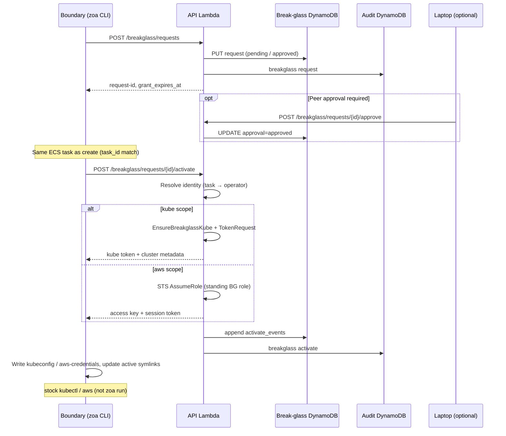
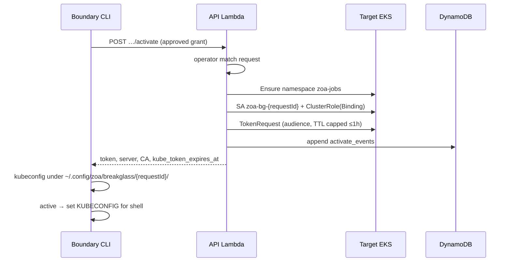
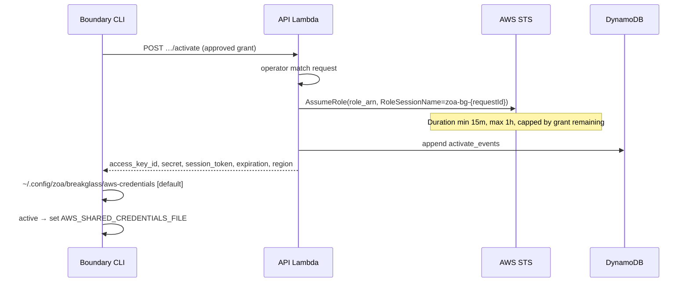

# Break-Glass — Credential Architecture

This document explains how **temporary** Kubernetes and AWS credentials are created, wired into the boundary shell, and torn down. It mirrors the structure of [Trusted Action execution flows](../architecture/implementation.md) (sync vs async there; **kube vs aws credential scope** here).

| Audience       | Read instead                                                                          |
| -------------- | ------------------------------------------------------------------------------------- |
| Operator       | [Break-glass README](README.md), [CLI break-glass](../cli-reference.md#break-glass)   |
| Profile author | [break-glass-profiles.md](../break-glass-profiles.md)                                 |

**Planes:** Break-glass uses the same **API Lambda** (VPC, EKS + STS) as Trusted Actions. The caller is always the **boundary task role** over SigV4; the laptop never receives bearer credentials. Human **`operator`** on audit rows comes from the [identity bridge](../boundary/identity-bridge.md), same as TA dispatch.

## Lifecycle (request → approve → activate)

Each grant is one **profile** (`name`, credential **scope** kube **or** aws per request). v1 profiles use `approval: none` so approve is automatic; peer approval is the same HTTP workflow as TAs ([approval workflow](../approval-workflow.md)).

**Activate is not implicit:** `request --wait` and `get --wait` only poll **approval**; the operator must run `zoa breakglass activate` explicitly (`internal/cli/breakglass_flow.go`).

## Activate flow (kube scope)

Profile metadata `scope: kube` drives RBAC from `pkg/breakglass/` (same RBAC structs as TAs, but **per-request** identity, not per-execution).

The API Lambda **control-plane client** creates resources; the boundary task role does **not** need permission to create cluster RBAC or to call `AssumeRole` for break-glass AWS roles.

## Activate flow (aws scope)

AWS break-glass profiles (`aws_read`, `aws_write`, `aws_elevated`) select a **pre-provisioned** IAM role via profile **`name`** → `BREAKGLASS_AWS_*_ROLE_ARN` (Terraform `breakglass_iam.tf` in **rosa-seaplane**). The Lambda execution role may `sts:AssumeRole` only into those roles.

**CloudTrail:** management events attribute the session to `zoa-bg-<request-id>` via `RoleSessionName` (`pkg/executor/breakglass_aws.go`).

## What gets created

Parallel to [What Gets Created](../architecture/implementation.md#what-gets-created) for TAs — break-glass favors **interactive** stock CLIs over a single Lambda execution.

### Kube scope

| Artifact              | Name / location                                   | Lifetime                                  |
| --------------------- | ------------------------------------------------- | ----------------------------------------- |
| ServiceAccount        | `zoa-jobs/zoa-bg-<requestId>`                     | Until worker GC after grant expiry        |
| ClusterRole + Binding | Rules from profile RBAC (`ClusterScoped: true`)   | Same                                      |
| Bearer token          | TokenRequest; not a long-lived Secret             | ≤ **1h** (also capped by grant time left) |
| Boundary files        | `~/.config/zoa/breakglass/<requestId>/kubeconfig` | Operator disk in boundary home            |
| Shell env             | `KUBECONFIG` via `active` + `PROMPT_COMMAND`      | While grant active and file present       |

**Kubernetes audit:** `user.username` is `system:serviceaccount:zoa-jobs:zoa-bg-<requestId>` — filter EKS audit logs on that SA name to correlate with the grant id.

Code path: `EnsureBreakglassKube` → `createBreakglassResourcesIdempotent` (`pkg/executor/breakglass_resources.go`), token issue (`pkg/executor/breakglass_kube.go`), HTTP handler `handleActivateBreakglassRequest` (`pkg/api/breakglass.go`).

### Aws scope

| Artifact       | Name / location                                                 | Lifetime                                           |
| -------------- | --------------------------------------------------------------- | -------------------------------------------------- |
| IAM session    | Assumed role from `BREAKGLASS_AWS_*_ROLE_ARN` env on API Lambda | **15m–1h** STS session                             |
| Session name   | `zoa-bg-<requestId>`                                            | Appears in CloudTrail `Username` / session context |
| Boundary files | `~/.config/zoa/breakglass/aws-credentials` (`[default]`)        | Rewritten on each aws scope activate               |
| Shell env      | `AWS_SHARED_CREDENTIALS_FILE` when aws grant active             | No `AWS_PROFILE`                                   |

No S3 job, no async runner, and no per-activation K8s Job — credentials return in the **activate HTTP response** and are written locally by the CLI (`internal/cli/breakglass_activate.go`).

## Three clocks (request, grant, credential)

| Clock           | Source                                                        | Effect                                                                                                     |
| --------------- | ------------------------------------------------------------- | ---------------------------------------------------------------------------------------------------------- |
| **Request TTL** | Profile `default_request_hours` → `request_expires_at`        | Pending request expires without decision                                                                   |
| **Grant**       | Profile `default_grant_hours` at approve → `grant_expires_at` | After expiry, `activate` returns gone; reconciler sets `status=expired`                                    |
| **Credential**  | `pkg/breakglass/credential.go` max + `min(grant left, max)`   | `kubectl` / `aws` stop when creds expire **even if grant still valid**; **409** if grant left &lt; API min |

Operators see grant + cred in PS1 (`grant~…`, `cred~…`); `active` stores `credentialExpiresAt`. Catalog: `zoa breakglass describe` / `profiles` (request, grant, credential TTL). Full UX: [README — Two clocks](README.md#two-clocks-grant-vs-credentials).

**Refresh:** `zoa breakglass activate <same-request-id>` again from any boundary session while `status=active`, `approval=approved`, and before `grant_expires_at`. Re-activate replaces tokens and STS keys; it does not create a new request.

## Boundary shell wiring

Break-glass credentials are **deliberately separate** from the ECS task role used by `zoa` for TAs.

| Tool      | Credential source                                                                                     |
| --------- | ----------------------------------------------------------------------------------------------------- |
| `kubectl` | `KUBECONFIG` → active kube break-glass kubeconfig                                                     |
| `aws`     | `AWS_SHARED_CREDENTIALS_FILE` → break-glass file when an aws grant is active; unset without aws grant |
| `zoa`     | Task role only (Lambda / TA plane); **ignores** break-glass files                                     |

At most one active **kube** and one active **aws** grant are tracked in `~/.config/zoa/breakglass/active` (written by `internal/cli/breakglassactivegrants` on `zoa breakglass activate`). The boundary image `PROMPT_COMMAND` reads that JSON and applies `KUBECONFIG` / `AWS_SHARED_CREDENTIALS_FILE` so operators do not hand-export keys.

## Audit and attribution

| Store                         | What to search                                                      |
| ----------------------------- | ------------------------------------------------------------------- |
| ZOA audit / break-glass table | `request_id`, `operator`, `scope`, `activate_events` (at, task, session) |
| EKS audit                     | `user.username` ~ `zoa-bg-<requestId>`                              |
| CloudTrail                    | Session / user name `zoa-bg-<requestId>` for assumed-role API calls |

The apiserver never sees the human username; attribution chains **boundary task** → identity bridge → **request row** → **SA or STS session name**.

**Data-plane forensics:** copy-paste CloudTrail and CloudWatch Logs Insights recipes keyed on `zoa-bg-<request-id>` → [forensics-evidence.md](forensics-evidence.md).

## Contrast with Trusted Actions

| Dimension    | Trusted Action                                 | Break-glass                                                           |
| ------------ | ---------------------------------------------- | --------------------------------------------------------------------- |
| Entry        | `zoa run <action>`                             | `zoa breakglass activate` then stock CLI                              |
| K8s identity | `zoa-exec-<executionId>` per run               | `zoa-bg-<requestId>` per grant                                        |
| AWS identity | Shared read/write TA roles per TA              | Standing BG roles + `zoa-bg-<requestId>` session                      |
| Execution    | Sync impersonation or async Job + `zoa-runner` | No executor `Execute()`; operator drives tools                        |
| Output       | S3 `output.json` + logs                        | Command stdout/stderr in boundary; platform logs only                 |
| Cleanup      | End of TA / Job / GC labels                    | Grant expiry + `CleanupBreakglass` (`pkg/scheduler/breakglass_gc.go`) |
| Approval     | TA metadata + workflow                         | Scope `authorization` + same approve HTTP pattern                     |

For TA internals (sync/async diagrams), see [implementation.md](../architecture/implementation.md).

## Expiry and cleanup

Worker hygiene runs on **`reconciler`** and **`gc`** ticks (`breakglassExpireGrants`, `breakglassGarbageCollect`, `breakglassOrphanGC` on `Reconciler` — see [Worker routes](../architecture/worker-routes.md); `BreakglassStore` wired in `NewReconciler` from `cmd/zoa-lambda/main.go`). Not a separate EventBridge schedule:

1. Pending requests past deadline → `expired`
2. Approved grants past `grant_expires_at` → `expired` (approval column unchanged)
3. For expired kube grants → `CleanupBreakglass` deletes `zoa-bg-<requestId>` SA/RBAC in `zoa-jobs`

STS sessions and kube tokens become invalid at their own TTL; GC is **RBAC hygiene** on the cluster.

## Infrastructure and configuration

| Concern                                                              | Where                                                                                 |
| -------------------------------------------------------------------- | ------------------------------------------------------------------------------------- |
| Break-glass DynamoDB table                                           | Terraform **rosa-seaplane** (`zoa` module); **`BREAKGLASS_TABLE` required** on Access, API, Worker (same as `EXECUTION_TABLE` / `SESSIONS_TABLE`) |
| Standing AWS BG roles + trust                                        | `terraform/modules/zoa-lambda/breakglass_iam.tf`                                      |
| API env: `BREAKGLASS_AWS_READ_ROLE_ARN`, `…_WRITE_…`, `…_ELEVATED_…` | Rendered per region/target                                                            |

Executor env mirrors TA EKS settings (`EKS_CLUSTER_*`, `ZOA_JOBS_NAMESPACE`) because the same API Lambda client mutates the cluster.

## Package map (quick)

| Package                        | Role                                                            |
| ------------------------------ | --------------------------------------------------------------- |
| `pkg/breakglass/`              | Profile catalog (scope kube\|aws, RBAC or IAM composition, TTL) |
| `pkg/api/breakglass.go`        | HTTP: request, approve, activate, list                          |
| `pkg/executor/breakglass_*.go` | Kube RBAC + token, STS assume                                   |
| `pkg/store/`                   | Break-glass request persistence                                 |
| `internal/cli/breakglassactivegrants/` | Go side of `active` + credential paths (shell prompt consumes `active`) |
| `internal/cli/breakglass*.go`  | Operator commands and activate artifact writes                  |
