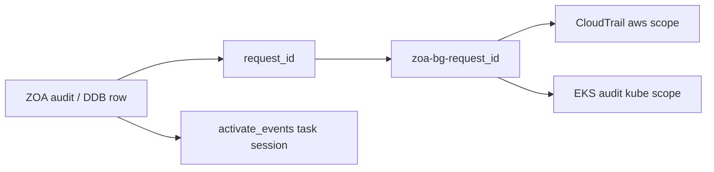

# Break-glass forensic evidence (by request id)

Until we ship a Trusted Action (or similar) to wrap these queries, use the **break-glass request UUID** as the single correlation key. Platform identity is always prefixed `zoa-bg-` — never the operator’s human name in CloudTrail or the Kubernetes apiserver audit.

| Grant `scope` | Where API calls show up | Search key |
| ------------- | ----------------------- | ---------- |
| **aws**       | CloudTrail (management events in the **target account**) | `Username` = `zoa-bg-<request-id>` (STS `RoleSessionName`) |
| **kube**      | EKS control plane audit log group for **that target’s cluster** | `user.username` contains `zoa-bg-<request-id>` (SA `zoa-jobs/zoa-bg-<request-id>`) |

**ZOA audit** (`zoa audit`, DynamoDB audit table) records **decision** events (`request`, `approve`, `activate`, …) and boundary attribution. It does **not** include every `kubectl` verb or `aws` API call — use the queries below for **data-plane** evidence.

## Prerequisites

From a workstation (not the boundary):

1. Pick the **AWS profile and region** for the **account that hosts the target** (regional cluster account for an RC grant, management cluster account for an MC grant — same account you would use to administer that EKS cluster).
2. Set the request id from `zoa breakglass get <id>` or `list` / `history`.

```bash
export AWS_PROFILE=<profile-for-target-account>
export AWS_REGION=<deployment-region>

BG_REQ_ID="<break-glass-request-uuid>"
BG_USER="zoa-bg-${BG_REQ_ID}"
```

## AWS scope — CloudTrail

Lists management API calls assumed under the break-glass STS session. Adjust the lookback window as needed.

```bash
aws cloudtrail lookup-events \
  --start-time "$(date -u -d '6 hours ago' +%Y-%m-%dT%H:%M:%SZ)" \
  --lookup-attributes AttributeKey=Username,AttributeValue="${BG_USER}" \
  --output json | jq -r '
    .Events[] | (.CloudTrailEvent | fromjson) |
    "\(.eventTime)\t\(.eventName)\t\(.errorCode // "OK")\t\(.readOnly // false)\t\(.errorMessage // "-")"
  ' | column -t -s $'\t'
```

If nothing returns, widen `--start-time` or confirm the grant was **aws** scope, **activated** in the matching target, and credentials were still valid when the CLI ran.

## Kube scope — CloudWatch Logs Insights (EKS audit)

EKS sends apiserver audit records to `/aws/eks/<cluster-name>/cluster`. Use the **cluster name** for the grant’s target (for example the regional or management cluster name shown as `TARGET` on the grant).

```bash
export AWS_PROFILE=<profile-for-target-account>
export AWS_REGION=<deployment-region>

BG_REQ_ID="<break-glass-request-uuid>"
BG_USER="zoa-bg-${BG_REQ_ID}"

LOG_GROUP="/aws/eks/<cluster-name>/cluster"
START=$(date -u -d '12 hours ago' +%s)
END=$(date -u +%s)

QUERY=$(cat <<EOF
fields @timestamp, user.username as user, verb, \`responseStatus.code\` as code,
       objectRef.resource as res, objectRef.namespace as ns, objectRef.name as name,
       \`responseStatus.message\` as msg
| filter @logStream like /kube-apiserver-audit/
| filter user.username like /${BG_USER}/
| sort @timestamp asc
| limit 100
EOF
)

QID=$(aws logs start-query \
  --log-group-name "$LOG_GROUP" \
  --start-time "$START" \
  --end-time "$END" \
  --query-string "$QUERY" \
  --query queryId --output text)

until [[ "$(aws logs get-query-results --query-id "$QID" --query status --output text)" == "Complete" ]]; do
  sleep 2
done

printf '%s\t%s\t%s\t%s\t%s\t%s\n' "TIME" "CODE" "VERB" "RESOURCE" "USER" "DETAIL"

aws logs get-query-results --query-id "$QID" --output json | python3 -c "
import json, sys
for row in json.load(sys.stdin).get('results', []):
    d = {p['field']: p['value'] for p in row}
    target = '/'.join(x for x in (d.get('res'), d.get('ns'), d.get('name')) if x) or '-'
    user = d.get('user') or ''
    sa = user.split(':')[-1] if user else '-'
    msg = (d.get('msg') or '-').replace('\t', ' ').replace('\n', ' ')
    print(f\"{d.get('@timestamp','')}\t{d.get('code','')}\t{d.get('verb','')}\t{target}\t{sa}\t{msg}\")
" | column -t -s $'\t'
```

Successful rows use HTTP **code** `201`/`200`/`204` etc.; denied calls show non-2xx **code** and **msg**.

## Chaining evidence



1. **ZOA audit** — who requested, approved, activated, from which boundary task (`activate_events`).
2. **CloudTrail or EKS audit** — what `aws` / `kubectl` did while credentials were valid.

See also [Credential architecture — Audit and attribution](credential-architecture.md#audit-and-attribution).