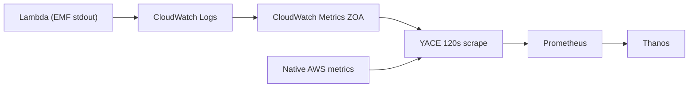

# ZOA Observability

ZOA observability has two pillars: **metrics** (CloudWatch EMF and native AWS
metrics → Thanos) for dashboards and alerts, and **logs** (CloudWatch Logs) for
debugging individual executions and operator sessions.

## Metrics Pipeline

Application metrics are published to CloudWatch namespace **`ZOA`** via EMF
(Lambda stdout → CloudWatch Logs → CloudWatch Metrics). **YACE** scrapes those
custom metrics and native AWS metrics (Lambda, DynamoDB, SQS, ECS Container
Insights) from regional and management cluster accounts into Prometheus → Thanos
on the RC.



**Expected end-to-end latency**: 5–7 minutes from EMF emission to metric
availability in Thanos. This is the sum of CloudWatch log ingestion (~1 min),
CloudWatch Metrics aggregation (~1–2 min), YACE scrape interval (120s), and
Prometheus scrape + remote-write (~30s).

## EMF Metrics Catalog

All EMF metrics are defined in `pkg/metrics/routes.go`. YACE exposes them as
Prometheus series: `aws_zoa_<metric_snake_case>_<statistic>`.

**CamelCase-to-snake_case gotcha**: YACE treats consecutive uppercase letters as
one token. GC-prefixed names become `gclast_run`, `gcduration`, etc. (not
`gc_last_run`).

Duration metrics are scraped with **Average** and **p99** in YACE; dashboards
and SLO panels typically use the `_p99` series.

| CloudWatch name             | Prometheus name (typical)                  |
| --------------------------- | ------------------------------------------ |
| `GCLastRun`                 | `aws_zoa_gclast_run_maximum`               |
| `GCDuration`                | `aws_zoa_gcduration_average`               |
| `GCErrors`                  | `aws_zoa_gcerrors_sum`                     |
| `GCCleanedResources`        | `aws_zoa_gccleaned_resources_sum`          |
| `ReconcilerLastRun`         | `aws_zoa_reconciler_last_run_maximum`      |
| `ReconcilerDuration`        | `aws_zoa_reconciler_duration_p99`          |
| `ReconcilerErrors`          | `aws_zoa_reconciler_errors_sum`            |
| `ReaperLastRun`             | `aws_zoa_reaper_last_run_maximum`          |
| `ReaperDuration`            | `aws_zoa_reaper_duration_p99`              |
| `ReaperErrors`              | `aws_zoa_reaper_errors_sum`                |
| `ExecutionCount`            | `aws_zoa_execution_count_sum`              |
| `ExecutionDuration`         | `aws_zoa_execution_duration_p99`           |
| `HttpRequestCount`          | `aws_zoa_http_request_count_sum`           |
| `HttpRequestDuration`       | `aws_zoa_http_request_duration_p99`        |
| `RejectionCount`            | `aws_zoa_rejection_count_sum`              |
| `CircuitBreakerStateChange` | `aws_zoa_circuit_breaker_state_change_sum` |
| `IdentityBridgeLookup`      | `aws_zoa_identity_bridge_lookup_sum`       |

### Emit functions

| Function                        | Dimensions                                                                    | When emitted                        |
| ------------------------------- | ----------------------------------------------------------------------------- | ----------------------------------- |
| `EmitHTTPRequest`               | Cluster, HandlerMode=`api`, Method, RouteTemplate, StatusClass                | Every API Lambda request            |
| `EmitAccessHTTPRequest`         | Cluster (see below), HandlerMode=`access`, Method, RouteTemplate, StatusClass | Every Access Lambda request         |
| `EmitExecution`                 | Cluster, Action, Status, Mode, Scope, Type                                    | Terminal TA state                   |
| `EmitRejection`                 | Cluster, Reason                                                               | Cooldown, validation, etc.          |
| `EmitReconciler` / `EmitGC`     | Cluster, HandlerMode                                                          | Worker reconciler / GC ticks        |
| `EmitReaper`                    | Cluster, HandlerMode                                                          | Worker session reaper tick (~5m)    |
| `EmitIdentityBridgeLookup`      | Cluster, Outcome (`hit`, `miss`, `error`, `skipped`)                          | API TA dispatch identity resolution |
| `EmitGCCleaned`                 | Cluster, ResourceType                                                         | GC cleaned a K8s object             |
| `EmitCircuitBreakerStateChange` | Cluster, State                                                                | Circuit breaker open/close          |

**Access HTTP `Cluster` dimension**

- **Session routes** (start, join, terminate, exec-attached): ZOA **target id** (same as audit `TARGET`, e.g. ephemeral MC id).
- **Deployment routes** (`/health`, `/version`, targets list, sessions list/history): **`DEPLOYMENT_NAME`** (regional deployment id).

The Grafana dashboard filters session Access traffic with `$cluster`; deployment
routes are shown separately. The **Access Availability** SLO stat aggregates all
Access HTTP fleet-wide (not filtered by the Cluster dropdown).

**Identity bridge**

- Emitted on the **API** Lambda when resolving operator identity from a boundary task role.
- **`skipped`**: caller did not use the bridge path (e.g. direct API URL from laptop/e2e) — excluded from the hit-rate SLO.
- **`hit` / `miss` / `error`**: SLO is `hit / (hit + miss + error)`.

### Time series shape

YACE exposes EMF dimensions as Prometheus labels (`dimension_Cluster`, `dimension_HandlerMode`,
`dimension_RouteTemplate`, etc.). MC metrics also carry federation labels such as `cluster` and
`cluster_type` after remote-write to Thanos. The dashboard **`$cluster`** variable filters on the
Prometheus `cluster` label (aligned with EMF **`Cluster`** for most TA/API/worker series).

The EMF **`Cluster`** value is the ZOA **target id** (RC or MC VPC id, e.g. `eph-…-regional` /
`eph-…-mc01`) for API Lambdas, Worker ticks, TA executions, and identity-bridge lookups. **Access
HTTP is mixed:** session routes use the session **target id**; deployment-wide routes use
**`DEPLOYMENT_NAME`** instead (see above). Those deployment-scoped series **do not** appear when
you filter only a target id in `$cluster` — the Access availability SLO stat sums all Access HTTP
fleet-wide for that reason.

| Metric (CloudWatch)                           | Typical Prometheus prefix                                      | `Cluster` / scope                    | Other dimensions (high level)                   | YACE stats (typical)               |
| --------------------------------------------- | -------------------------------------------------------------- | ------------------------------------ | ----------------------------------------------- | ---------------------------------- |
| `HttpRequestCount`                            | `aws_zoa_http_request_count_sum`                               | Target id; Access also deployment id | HandlerMode, Method, RouteTemplate, StatusClass | Sum; duration Avg/p99              |
| `HttpRequestDuration`                         | `aws_zoa_http_request_duration_*`                              | Same as count                        | Same                                            | Average, p99                       |
| `ExecutionCount`                              | `aws_zoa_execution_count_sum`                                  | Target id                            | Action, Status, Mode, Scope, Type               | Sum                                |
| `ExecutionDuration`                           | `aws_zoa_execution_duration_*`                                 | Target id                            | Action, Status, Mode, Scope, Type               | Average, p99                       |
| `IdentityBridgeLookup`                        | `aws_zoa_identity_bridge_lookup_sum`                           | Target id (API)                      | Outcome (`hit`, `miss`, `error`, `skipped`)     | Sum                                |
| `Reconciler*` / `GCLastRun` / `ReaperLastRun` | `aws_zoa_reconciler_*`, `aws_zoa_gclast_*`, `aws_zoa_reaper_*` | Target id (Worker)                   | HandlerMode on ticks                            | Sum / Max; GC & reaper 600s period |
| `RejectionCount`                              | `aws_zoa_rejection_count_sum`                                  | Target id                            | Reason                                          | Sum                                |

**Route templates** (HTTP count/duration): low-cardinality paths from `metrics.NormalizeRoute` —
e.g. `POST /api/v0/sessions/start`, `GET /api/v0/targets`, `POST /api/v0/trusted-actions/{action}/run`
— not raw URLs with session UUIDs.

**Non-EMF (platform YACE):** `AWS/Lambda` for `*-zoa-api` and `*-zoa-worker` (per `tag_Cluster`);
regional `*-zoa-access` is one function per RC deployment; **`ECS/ContainerInsights` `TaskCount`**
on `{target_id}-zoa-boundary`. Configured in **rosa-seaplane** `cloudwatch-exporter` values, not in
this repo.

### Cost model

EMF custom metrics are billed by CloudWatch at roughly **~$0.30/custom metric/month**
(unique metric name + dimension set). Native AWS metrics scraped by YACE (Lambda,
DynamoDB, SQS, ECS) do not use that EMF price; you pay mainly **YACE/CW API**
scrape cost instead.

**Fixed-ish footprint (per target id — each MC and the RC VPC):** reconciler, GC,
reaper ticks, API HTTP (route × status class), identity-bridge outcomes, circuit
breaker, rejections — on the order of **~$28–38/month** in EMF terms today (was
~$24 when the doc only listed api/worker/reconciler/GC). The bump is mostly **Access
session HTTP** (extra routes and target ids), **reaper**, and **bridge** lookups,
not a new pricing model.

**RC deployment (once per region):** the **Access** Lambda adds another block of
HTTP series (session routes per target id plus a small set of deployment-wide
routes). Budget **~$5–12/month** on top of the RC target-id footprint depending on
how many MC targets get sessions (still not per-operator).

**Variable (still dominates in busy regions):** `EmitExecution` — roughly **~$2–3/month
per TA** per target id in normal use (action × status × mode × scope), same idea as
the old **~$2.50/TA** rule of thumb.

**Quick estimate:** ~~**$35–50/month EMF per MC** with a typical small TA catalog,
plus **~$40–55/month** for the RC stack (regional target + Access), before scaling
with many actions or heavy session churn. Treat as **order-of-magnitude** for
capacity planning; count exact series in CloudWatch console if you need a quote.

Platform YACE also scrapes non-EMF series used on the ZOA dashboard; see **Time series shape**
above and `cloudwatch-exporter` in **rosa-seaplane**.

## Recording Rules, Alerts, and Dashboard

Recording rules, alerting rules, and the Grafana **ZOA** dashboard live in
[`rosa-seaplane`](https://github.com/openshift-online/rosa-seaplane):

| What                       | Source of truth                                                                                                                                                                                    |
| -------------------------- | -------------------------------------------------------------------------------------------------------------------------------------------------------------------------------------------------- |
| Recording rules and alerts | [`argocd/config/regional-cluster/alerting-rules/templates/zoa.yaml`](https://github.com/openshift-online/rosa-seaplane/blob/main/argocd/config/regional-cluster/alerting-rules/templates/zoa.yaml) |
| Dashboard                  | [`argocd/config/regional-cluster/grafana/dashboards/zoa/zoa.json`](https://github.com/openshift-online/rosa-seaplane/blob/main/argocd/config/regional-cluster/grafana/dashboards/zoa/zoa.json)     |
| YACE scrape config (RC)    | [`argocd/config/regional-cluster/cloudwatch-exporter/values.yaml`](https://github.com/openshift-online/rosa-seaplane/blob/main/argocd/config/regional-cluster/cloudwatch-exporter/values.yaml)     |
| YACE scrape config (MC)    | [`argocd/config/management-cluster/cloudwatch-exporter/values.yaml`](https://github.com/openshift-online/rosa-seaplane/blob/main/argocd/config/management-cluster/cloudwatch-exporter/values.yaml) |

Refer to those files for the definitive list of rule names, alert thresholds,
`for` durations, and PromQL expressions. Below is the design philosophy — the
_why_ behind the choices, which changes less often than the _what_.

**Changes since the first ZOA observability doc (do not treat old prose as truth):**

- **Access** — session-plane HTTP (EMF `HandlerMode=access`), native Lambda
  `*-zoa-access`, and **Access availability** SLO (alongside API).
- **Lambda SLO alerts** — combined **api + worker + Access** per cluster
  (`zoa:lambda_error_rate`, `zoa:lambda_throttle_rate`) with a minimum
  invocation guard (see `zoa.yaml`), not per-function alert names.
- **Identity bridge** — hit-rate recording rule and SLO alert (`skipped`
  outcomes excluded from the ratio).
- **Session reaper** — EMF tick metrics and stall detection (same pattern as
  reconciler/GC tick health).
- **Worker tick phase errors** — warning alerts on sustained EMF error counters
  (reconciler / GC / reaper); thresholds live only in `zoa.yaml`.
- **Grafana** — extra rows for Access HTTP, Workers, boundary task count; Lambda
  infra row includes **Throttles** (four panels: invocations, errors, duration
  p99, throttles).

### Recording rules

Recording rules pre-compute values consumed by alerts and dashboard panels.
They fall into three categories:

- **SLO ratios** — Global TA success rate (`zoa:ta_success_rate`). API HTTP
  availability (`zoa:api_availability`, HandlerMode=`api`). **Access** HTTP
  availability (`zoa:access_availability`, HandlerMode=`access`). **Combined
  Lambda** error and throttle rates per cluster (`zoa:lambda_error_rate`,
  `zoa:lambda_throttle_rate` from `zoa:lambda_*_combined`, api/worker plus
  regional Access). **Identity bridge** hit rate (`zoa:identity_bridge_hit_rate`:
  `hit / (hit + miss + error)`; `skipped` not in the denominator).
- **Tick health** — Gap-filled last-run timestamps and `changes()` counts for
  **reconciler**, **GC**, and **reaper** (`zoa:*_last_run`, `zoa:*_tick_count`).
  CloudWatch EMF metrics have natural gaps in the 5–10 minute scrape/aggregation
  cycle; `last_over_time()` in the recording rules fills those gaps so stall
  alerts and worker panels have a value between ticks.
- **Traffic guards** — Total TA execution volume (`zoa:ta_total_executions`) and
  combined Lambda invocations (`zoa:lambda_invocations_combined`) so SLO and
  Lambda alerts suppress false positives on idle or nearly idle clusters.

SLO **target numbers** (e.g. 99% API/Access, 95% TA and bridge) are in
`alerting-rules/values.yaml`, not hard-coded in this doc.

### Alerting philosophy

Two severity levels:

- **Critical** (page oncall) — ZOA's operational capability is lost. Reserved for
  **total TA failure** (dependency outage; backstop below individual SLO) and
  **reconciler stall** (async pipeline stops advancing — silent failure mode).
  These require human intervention to restore ZOA's ability to respond to
  incidents.
- **Warning** (Slack / ticket) — Degradation that needs attention but is not an
  immediate customer-facing risk. Includes **SLO breaches** (TA success, API and
  Access HTTP availability, identity-bridge hit rate), **combined Lambda** high
  error or throttle rate, **worker tick stalls** (GC, reaper — same family as
  reconciler stall but lower urgency), **sustained worker tick phase errors**
  (EMF counters on reconciler/GC/reaper ticks), DLQ growth, DynamoDB throttling,
  and circuit-breaker flapping.

Design constraints for a fleet of 40+ regions:

- Alerts aggregate **per cluster** (Prometheus `cluster` / target id), not per TA
  action or Lambda function — oncall burden stays proportional to regions, not
  to action count. Drill-down is via the **ZOA** dashboard and CloudWatch Logs
  (function name, route, action).
- **SLO and Lambda alerts** include **traffic guards** (minimum executions or
  invocations) so idle clusters do not page on a single failed request or a
  handful of Lambda invocations.
- **`for` durations** are long enough to absorb the **5–7 minute** CloudWatch →
  YACE → Thanos pipeline delay (often 15–20 minutes on warnings; stall critical
  uses shorter `for` but stricter staleness logic — see `zoa.yaml`).
- Every alert carries a **`runbook`** annotation with troubleshooting steps;
  treat those as the operator-facing detail that can evolve into SOPs.

**Authoritative list:** names, PromQL, thresholds, and `for` for every rule are
only in [`zoa.yaml`](https://github.com/openshift-online/rosa-seaplane/blob/main/argocd/config/regional-cluster/alerting-rules/templates/zoa.yaml).
Do not duplicate them here.

**Native AWS caveat:** DynamoDB **`ThrottledRequests`** may not exist in
CloudWatch until AWS has recorded at least one throttle (on-demand tables often
show **no data** while healthy). The warning alert and dashboard panel are
correct; empty series means no throttles observed, not a misconfigured metric
name in YACE.

### Dashboard sections

The live layout is in `zoa.json`. At a high level:

- **ZOA SLO Overview** — Stat panels over the **dashboard time range** (not the
  same rolling window as Thanos `for`): TA success rate, API availability,
  **Access availability**, **Lambda error rate** (combined api/worker/Access),
  identity-bridge hit rate, execution count, sync/async execution P99, DLQ
  depth. Ratio stats need traffic in-range; DLQ/P99 are point-in-time at range
  end where noted in panel descriptions.
- **ZOA Activity Overview** — Executions by cluster, status, scope, type, mode;
  **boundary** running task count (ECS Container Insights proxy for active
  sessions).
- **ZOA Trusted Action Executions** — Per-action count, duration, rejections
  (respects `$action` and `$cluster`).
- **ZOA HTTP API** — API Lambda (HandlerMode=`api`): requests by route and status,
  5xx vs 4xx, P99 duration, **identity bridge** lookups by outcome.
- **ZOA Access & Boundary sessions HTTP API** — Access Lambda HTTP: session vs
  deployment routes, status breakdown (see Access `Cluster` dimension above).
- **ZOA Workers** — Reconciler / GC / **reaper** duration and errors, tick
  health, circuit breaker state changes.
- **Infrastructure** — **Lambda**: invocations, errors, duration p99,
  **throttles** (api/worker via `tag_Cluster` + Access on RC; same pattern on
  all four panels). **DLQ** depth and age. **DynamoDB** throttled requests
  (may be empty until CW emits the metric), latency p99, consumed capacity.

Dashboard variables: `$datasource`, `$cluster` (RC/MC target ids from EMF
reconciler heartbeat), `$action` (TA name).

## Lambda logs

Each ZOA Lambda function writes structured JSON logs to **CloudWatch Logs**. These
are the primary tool for debugging individual executions, reconciler ticks, GC runs,
Access session handling, and reaper ticks.

**Not the same as boundary Exec logs.** Interactive shell transcripts live under
**`/ecs/<cluster_id>/zoa-boundary/...`** (different log groups, different Insights
filters). See [boundary session logging](boundary/session-logging.md#viewing-session-logs-in-grafana-explorer).

### Log group naming

Terraform creates one log group per Lambda function (`terraform/modules/zoa-lambda`,
`terraform/modules/zoa-access` in **rosa-seaplane**):

| Lambda     | Deployed in                         | CloudWatch log group                   |
| ---------- | ----------------------------------- | -------------------------------------- |
| **API**    | Each target VPC (RC + each MC)      | `/aws/lambda/<cluster_id>-zoa-api`     |
| **Worker** | Each target VPC (RC + each MC)      | `/aws/lambda/<cluster_id>-zoa-worker`  |
| **Access** | **RC account only** (session plane) | `/aws/lambda/<regional_id>-zoa-access` |

- **`<cluster_id>`** — Seaplane target id for that VPC (`regional_id` on the RC stack,
  `management_id` on each MC stack), e.g. `eph-1935238e-regional`, `eph-1935238e-mc01`.
- **`<regional_id>`** — RC cluster id from `cluster_naming.rc_pattern` (same value as
  the RC `cluster_id` in typical layouts). Access is **one function per regional
  deployment**, not per MC.

**Example (ephemeral RC, profile `rrp-regional-dev`, `us-east-1`):**

```
/aws/lambda/eph-1935238e-regional-zoa-access
/aws/lambda/eph-1935238e-regional-zoa-api
/aws/lambda/eph-1935238e-regional-zoa-worker
```

On an MC account, expect `/aws/lambda/<mc_id>-zoa-api` and `-zoa-worker` only (no
Access log group in that account).

### Viewing logs in Grafana Explorer

1. Open **Grafana → Explore**.
2. Select the **CloudWatch Logs** datasource for the **AWS account that owns the Lambda**:
   - RC Lambdas (api, worker, **access**) → regional cluster account datasource.
   - MC Lambdas (api, worker) → management cluster account datasource.
3. Switch to **CloudWatch Logs** mode (not Metrics).
4. **Search log groups** and type `/aws/lambda/` plus your cluster or regional id.
5. Select the function(s) you need (`-zoa-api`, `-zoa-worker`, and/or `-zoa-access` on RC).

CloudWatch Logs Insights examples:

```
fields @timestamp, @message
| sort @timestamp desc
| limit 50
```

```
# Errors only
fields @timestamp, @message
| filter @message like /error/i
| sort @timestamp desc
| limit 50
```

```
# Trace one execution id in worker/api logs
fields @timestamp, @message
| filter @message like /execution_id/
| sort @timestamp desc
```

Access Lambda logs cover session start/join, DynamoDB session rows, ECS `RunTask`, and
exec-attached registration — use the **`-zoa-access`** group on the RC account, not the
MC api/worker groups.

## E2E validation

The monitoring E2E suite (`test/e2e-monitoring/`) checks that metrics reach
Thanos and alerting rules are loaded. See [e2e-testing.md](e2e-testing.md#monitoring-suite-details).
